# Amadeus

<picture>
  <source media="(prefers-color-scheme: dark)" srcset="banner/amadeus_dark.svg">
  <source media="(prefers-color-scheme: light)" srcset="banner/amadeus_light.svg">
  
</picture>

<h3>A "simple" neural network.</h3>

(⁠◕⁠ᴗ⁠◕⁠✿⁠)

---

## About this project

**Amadeus** is a lightweight, edge-AI system designed for real-time Beats Per Minute (BPM) estimation from live music streams. Driven by a custom Binary Neural Network (BNN), it is fully optimized to run on resource-constrained microcontrollers like the ESP32-C3 (RISC-V).

> [!NOTE]
> This project's name is inspired by the advanced AI system _Amadeus_ created by 2 neuroscientists and researchers _Makise Kurisu_ and _Hiyajo Maho_ in [**Steins;Gate 0**](<https://steins-gate.fandom.com/wiki/Steins;Gate_0_(anime)>) movie.
>
> **_"This is the choice of Steins Gate. El. Psy. Congroo."_**

---

## Technical Architecture

This project is divided into 3 subcomponents: **trainer**, **simulator** and **device**.

### Trainer Component

- This component trains the Binary Neural Network, export the weights and thresholds to **simulator** component.

| **Specification** | **Value**             |
| :---------------- | :-------------------- |
| **Path**          | `components/trainer/` |
| **Languages**     | Python                |

### Simulator Component

- This component implements the whole Binary Neural Network (**forward propagation only**) from scratch, and acts as a Proof of Concept (PoC) of the whole project.

| **Specification**      | **Value**                            |
| :--------------------- | :----------------------------------- |
| **Path**               | `components/simulator/`              |
| **Languages**          | C++26                                |
| **CMake Version**      | CMake 4.2+                           |
| **Compiler Version**   | `clang++` $\geq 18$, `g++` $\geq 14$ |
| **External Libraries** | None.                                |

### Device Component

- This component implements the PoC from **simulator** component to the MCU.

| **Specification** | **Value**            |
| :---------------- | :------------------- |
| **Path**          | `components/device/` |
| **Languages**     | C++26, C23           |
| **CMake Version** | CMake 3.16+          |

---

## Basic Instructions

Coming soon!

---

## Contributors

**Many thanks for the contributors!**

---

## References & Citations

1. [Yuan, C., & Agaian, S. S. (2023). A comprehensive review of binary neural network. Artificial Intelligence Review, 56(11), 12949-13013.](https://arxiv.org/pdf/2110.06804)
